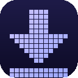

# Downy

A download manager in the style of IDM. A Chrome extension puts a "Download this video" button over videos on YouTube and the other sites yt-dlp supports, and hands normal Chrome downloads to the Downy desktop app, which opens, shows the progress and saves the file.

## What it does

- Downloads each file over several connections at once (8 by default). When a connection finishes its part, it takes half of the largest part still running, so all connections stay busy until the end.
- Pauses and resumes any download. Progress is saved to disk every second, so a download picks up where it stopped even after Downy or Windows restarts.
- Runs several downloads at the same time (3 by default) and queues the rest.
- Shows the button over videos on any site yt-dlp supports, such as Vimeo, Reddit, X, Dailymotion or Streamable, when the pointer is over the video. Embedded players get it too. On a site yt-dlp doesn't know, no button shows: Downy asks yt-dlp about the page once, with its catch-all "generic" extractor turned off, and that answer comes back in about a second. The extension passes the site's cookies to yt-dlp, so videos that need a sign-in work. YouTube never gets cookies, because yt-dlp warns that they can get an account flagged.
- Takes over normal Chrome downloads of 1 MB or more, with the page's cookies and referrer, so signed-in downloads work. Chrome keeps the download when Downy is closed or the link only works inside the browser. The extension popup has a switch to turn this off. You can also paste any file link into Downy.
- Asks before each download from Chrome in a small window near the top of the screen. After you pick a quality in the menu on the page, or when Chrome hands over a file, the window shows the file name, the folder and, for a video, the format, and you can change all three. Enter starts the download and Esc cancels it. Turn it off in Settings, Ask before each download.
- Sorts finished files inside the download folder you choose:

  ```
  Downloads\          files from Chrome and pasted file links
  YouTube\
    MP3\  M4A\  720p\  1080p\  2160p\ ...
  Videos\             videos from every other site, sorted the same way
    720p\  1080p\  Best\ ...
  ```
- Lives in the system tray. Closing the window keeps downloads running. Quit from the tray icon.
- Can start with Windows (Settings, Start with Windows).

## Parts

- `app/` is the desktop app (Electron). It serves a small local API on `http://127.0.0.1:9614` for the extension and accepts requests only from Chrome extensions.
  - `src/main/segmented.js` is the multi-connection downloader.
  - `src/main/manager.js` is the queue, pause and resume, saving state, and the ffmpeg merge or MP3 conversion.
  - `src/renderer/` is the window. The background is the Nyx pixel sky from T3 Code.
  - `src/main/updater.js` checks GitHub releases and installs updates with electron-updater.
  - `src/main/prompt.js` and `src/renderer/prompt.html` are the small window that asks before a download starts.
  - `src/main/installer.js` installs missing tools with winget.
  - `src/main/extension.js` copies the bundled extension into Downy's data folder and tracks whether Chrome has loaded it.
- `extension/` is the Chrome extension. The installer bundles it.
  - `overlay.js` is the button and the quality menu.
  - `content.js` puts it over the YouTube player, and `video.js` over videos on every other site.
  - `background.js` talks to Downy and hands Chrome downloads over to it.
  - `popup.html` lists recent downloads.

## Requirements

- `yt-dlp` and `ffmpeg`. Downy finds them on PATH or in winget's install folder.
- Node.js or Deno, which yt-dlp needs to read YouTube.

When any of them is missing, Downy offers to install it with winget (`yt-dlp.yt-dlp`, `Gyan.FFmpeg`, `DenoLand.Deno`), on the welcome screen or from Settings, Install tools. Once a day Downy runs `winget upgrade yt-dlp.yt-dlp` when yt-dlp came from winget, since YouTube changes often.

## Install

1. Open the [latest release](https://github.com/konik-yt/downy/releases/latest) and download `Downy-Setup-<version>.exe`, or `Downy-<version>-portable.exe` to run it without installing. The exe is not code signed, so Windows SmartScreen may warn you. Click "More info", then "Run anyway".
2. Start Downy. The welcome screen asks for a download folder, then walks you through adding the Chrome extension, which comes with Downy. Chrome only allows this kind of extension by hand: open `chrome://extensions`, turn on Developer mode, click "Load unpacked" and pick the folder Downy shows. The screen turns green once Chrome has loaded it.
3. Open any YouTube video and click "Download this video".

You can open the extension steps again from Settings, Chrome extension, Set up.

### Updating

Downy checks GitHub for a new release when it starts and every 4 hours. The installed app downloads the new version in the background, then shows "Restart to update" at the top right of the window and in the tray menu. Click it and Downy saves the downloads, installs the update and starts again, and the downloads that were running continue. If you don't click it, the update installs the next time you quit Downy. Settings, Updates shows the current version and has a "Check now" button.

The portable exe can't replace itself, so it only shows that a new version is out, with a button that opens the release page.

Versions before 2.2 have no updater. Run the new `Downy-Setup-<version>.exe` over the old one once. Your settings, history and unfinished downloads stay in `%APPDATA%\Downy`.

Downy keeps its copy of the extension in `%APPDATA%\Downy\Chrome extension` and refreshes it after each update, so Chrome picks up the new extension the next time it starts. You can also click the reload button on Downy in `chrome://extensions` to load it right away. If you loaded the extension from a zip or from this repo before 2.1, Downy asks once to switch to its own copy.

## Build from source

```
cd app
npm install
npm start          # run from source
npm run dist       # build the installer and the portable exe into app/dist
```

For testing, `DOWNY_USER_DATA` points Downy at a separate settings and history folder, `DOWNY_PORT` moves the local API off 9614, `DOWNY_UPDATE_URL` points the updater at a folder with `latest.yml` and a setup exe instead of GitHub, and `DOWNY_SCREENSHOT` saves screenshots of the window every few seconds.

A yt-dlp from somewhere other than winget is not upgraded by Downy. Keep it current with `yt-dlp -U`.

## Releasing

The Release workflow in `.github/workflows/release.yml` builds the installer, the portable exe and the extension zip on GitHub and publishes them as a release. Start it from the Actions tab (Release, then "Run workflow") or with:

```
gh workflow run release.yml                      # next patch version, like 2.0.1
gh workflow run release.yml -f bump=minor        # like 2.1.0
gh workflow run release.yml -f version=3.0.0     # an exact version
```

Each release carries `latest.yml` and `Downy-Setup-<version>.exe.blockmap` next to the exes. The updater in Downy reads them, so don't delete them from a release.

If the version in `app/package.json` has no release yet, the workflow releases that version as it is. Otherwise it raises the version, writes it to `app/package.json` and `extension/manifest.json`, commits that to the branch and tags the commit.

## Credits

The pixel sky background, the grid and the glass styles come from the Nyx theme for [T3 Code](https://github.com/pingdotgg/t3code), made by [Deepu (@Deepusleepy)](https://github.com/Deepusleepy). Thanks to Deepu for the art.
